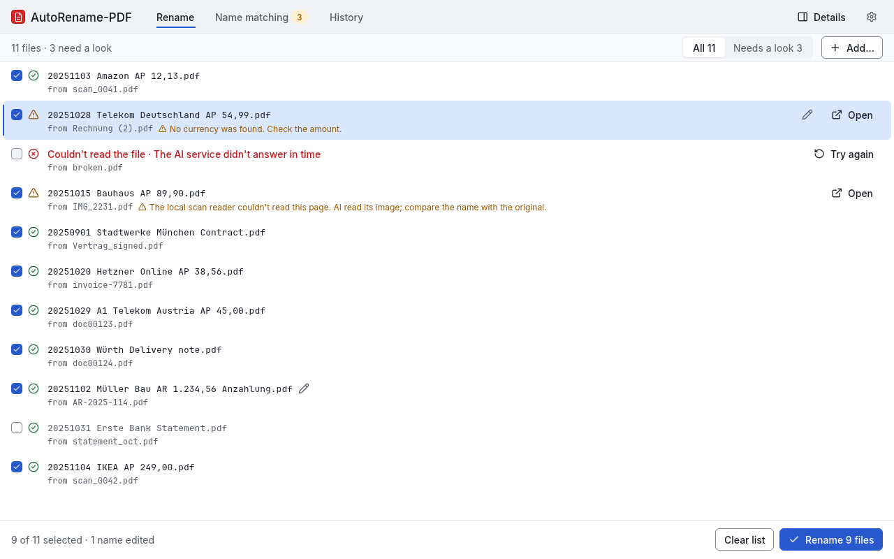

<div align="center">
  <h1>AutoRename-PDF</h1>
  <p><b>Rename PDFs from their content with AI and local OCR.</b><br>
  <code>acme-invoice.pdf</code> → <code>20240315 ACME Corporation AP EUR 4,258.80.pdf</code></p>
  <p>
    <a href="https://github.com/realspqrk/autorename-pdf/releases"></a>
    <a href="https://github.com/realspqrk/autorename-pdf/blob/main/LICENSE"></a>
    <a href="https://github.com/realspqrk/autorename-pdf/releases"></a>
    
  </p>
</div>

Drop in invoices, letters and scans; get files named by date, company, document type and amount. AutoRename-PDF reads each PDF, asks an AI model (OpenAI, Anthropic, Gemini, xAI, or a local Ollama model) what it is, renames the file, and keeps the extracted data inside the PDF. Every change can be undone.

> **4.0 is in beta.** Version 4 is a rewrite: one app with a window and a command line for Windows, macOS and Linux, plus local OCR for scans. Download **[4.0.0-beta.1](https://github.com/realspqrk/autorename-pdf/releases/tag/v4.0.0-beta.1)**; the last stable release is [3.2.0](https://github.com/realspqrk/autorename-pdf/releases/tag/v3.2.0). Coming from 3.x? Read the [migration guide](docs/migration-3-to-4.md) first. Found a problem? [Open an issue](https://github.com/realspqrk/autorename-pdf/issues).

<picture>
  <source media="(prefers-color-scheme: dark)" srcset="docs/images/gui-preview-dark.png">
  
</picture>

## Install

Download from the [4.0.0-beta.1 release](https://github.com/realspqrk/autorename-pdf/releases/tag/v4.0.0-beta.1). Each package contains the app window and the `autorename-pdf` command. `SHA256SUMS-<platform>` files list the checksums.

| System | File | Install |
|---|---|---|
| Windows 10/11 (x64) | `AutoRename-PDF_4.0.0-beta.1_x64-setup.exe` | Double-click it; no admin rights needed. Then open AutoRename-PDF from the Start menu. |
| macOS 11+ (Apple silicon) | `AutoRename-PDF_4.0.0-beta.1_aarch64.dmg` | Open it and drag AutoRename-PDF into Applications. Signed and notarized by Apple. |
| Linux (x86_64, any distro) | `autorename-pdf_4.0.0-beta.1_x86_64.AppImage` | `chmod +x autorename-pdf_*.AppImage`, then run it. |
| Ubuntu 24.04+ / Debian 13+ | `autorename-pdf_4.0.0.beta.1_amd64.deb` | `sudo apt install ./autorename-pdf_*_amd64.deb` |
| Arch / Omarchy | `autorename-pdf_4.0.0beta.1_x86_64.tar.gz` + `PKGBUILD` | `makepkg -si` in a folder holding both. |

On Linux, run `integrate install` once for the menu entry and the right-click entries: `./autorename-pdf_*.AppImage integrate install` (AppImage) or `autorename-pdf integrate install`. Install details (uninstall, AppImage without FUSE): [docs/guide.md](docs/guide.md#install-details).

## Rename your first PDFs

1. **Open AutoRename-PDF.** The first time, a setup card asks how documents are read. Choose **Cloud provider**, paste your API key, click **Test connection**, enter your company name and click **Save and continue**. An API key is an access code from your AI provider, which charges per use; use a key from your company's account. **Get a key** next to the field opens your provider's key page (OpenAI: [platform.openai.com/api-keys](https://platform.openai.com/api-keys)). Prefer to keep everything on your computer? Install [Ollama](https://ollama.com) and download a model first ([offline checklist](docs/guide.md#offline-mode)), then choose **Offline on this computer**.
2. **Drop PDFs or folders** into the window.
3. **Check the proposed names.** Files that need a look have **Open** to compare with the original PDF. To change a name, click the pencil (or double-click the name, or press F2). Press **Rename**.
4. Changed your mind? **Undo rename** on the result screen, or later under **History**.

Also on the right-click menu of PDFs and folders: **AutoRename-PDF > Rename now** (renames straight away unless something needs a look) or **Preview** (Windows 11: under "Show more options").

Your company name tells bills you receive (`AP`) from invoices you send (`AR`); change it under Settings (gear icon) > Naming. To see why a name was chosen, open the details panel (button at the right of the header, or <kbd>Ctrl</kbd>+<kbd>\</kbd>).

**Privacy in plain words:** text is read on your computer first. With the default settings, the text of the first three pages goes to the AI provider you chose; page images are sent only when the text cannot be read locally. You can change both in Settings (gear icon) > Processing. In offline mode documents stay on your computer or local network. [More](docs/guide.md#how-a-pdf-is-read).

## Command line in 60 seconds

The examples use bash (Windows PowerShell setup: `autorename-pdf setup --help`). `demo` is a copy of the repository's seven sample PDFs (`cp -r examples/demo ./demo`; all outputs in [its README](examples/demo/)); use your own folder instead.

```console
$ export OPENAI_API_KEY=sk-...
$ autorename-pdf setup --provider openai --api-key-env OPENAI_API_KEY --company "Spqrk"
$ autorename-pdf rename --dry-run demo          # preview; changes nothing
  acme-invoice.pdf           →  20240315 ACME Corporation AP EUR 4,258.80.pdf
  globex-letter.pdf          →  20250122 Globex Corporation Letter.pdf
  ...
  invoice-to-wayne.pdf       →  20250310 Wayne Enterprises AR EUR 10,700.00.pdf
  rechnung-mustermann.pdf    →  20250208 Mustermann Consulting AP EUR 1.320,00.pdf
  ...
Dry run: 7 to rename (nothing changed)
$ autorename-pdf rename demo                    # rename for real (analyzes again;
                                                # rename --plan + apply analyzes once)
$ autorename-pdf undo                           # everything back, byte for byte
```

`setup` is safe to re-run and stores the key in a `.env` file beside the config, never in the config itself. Offline instead: `ollama pull gemma4`, then `autorename-pdf setup --offline --ollama-model gemma4 --company "Spqrk"` ([checklist](docs/guide.md#offline-mode)).

**`autorename-pdf --help` is the manual.** It starts with the typical workflow and lists the exit codes; `autorename-pdf <command> --help` explains each command's options and side effects, with examples. Add `-o json` to any command for machine-readable output.

```bash
autorename-pdf rename -r ~/Documents/Inbox              # include subfolders
autorename-pdf rename --plan plan.json ~/Scans          # save the proposal; change nothing
autorename-pdf apply plan.json                          # rename from it, no new AI calls
autorename-pdf rename --ocr=on --vision=off scan.pdf    # read scans locally, never send images
autorename-pdf setup --ocr-models                       # local OCR for scans (~40 MB, once)
autorename-pdf undo --list                              # all past runs; undo --batch <id>
```

## Use the extracted data

Each renamed PDF carries an `autorename-pdf.json` attachment with the fields, the page text that was used and the model. Scripts, spreadsheets and other AI tools can reuse it without reading the PDF again:

```console
$ autorename-pdf inspect demo/*.pdf -o json \
    | jq -r '.files[].embedded.attachment.fields | [.document_date, .company_name, .currency, .total_amount] | @csv'
"15.03.2024","ACME Corporation","EUR","4,258.80"
"28.06.2024","Initech Solutions","EUR","237.50"
...
```

Any PDF tool can read the attachment too (qpdf, pdfdetach: [examples](docs/guide.md#embedded-data)). The title, subject, keywords and XMP metadata are set as well, so desktop search and document systems find the data. Signed, encrypted and PDF/A files and e-invoices are renamed but left byte-identical.

## Keep company names consistent

The app remembers each company the first time you rename a PDF from it and reuses that spelling. In the Name matching tab: if the same company appears twice, select the spelling you don't want, choose **Merge into**, and pick the name to keep. To change one company's spelling, choose **Rename**. Existing file names stay as they are; future documents use the new name. On the command line ([full walkthrough](docs/guide.md#name-matching)):

```console
$ autorename-pdf names rename "ACME Corporation" ACME
$ autorename-pdf rename --dry-run demo/acme-invoice.pdf     # a fresh copy of the demo file
  acme-invoice.pdf  →  20240315 ACME AP EUR 4,258.80.pdf
```

`names review` lists names the app was unsure about; `names merge` joins two entries. How matching works: [docs/guide.md](docs/guide.md#name-matching).

## Customize

| Profile | Example file name |
|---|---|
| `business` (default) | `20240315 ACME AP EUR 4,258.80.pdf`: date, company, AP/AR (bill received / invoice sent), total |
| `academic` | `20260101 Smith Nature Attention Is All You Need.pdf`: date, first author, venue, title |
| your own | any fields and template under `profiles:` in the config |

```yaml
# config.yaml: add the printed invoice number to business names
profiles:
  business:
    fields:
      invoice_id:
        description: "Copy the printed invoice number exactly. Empty if absent."
    template: "{document_date} {company_name} {document_type} {description} {invoice_id}"
```

Every key with its default: [config.yaml.example](config.yaml.example). Ready-made recipes (academic, German ER/AR, invoice number, offline, cloud vision): [examples/](examples/). `autorename-pdf config path` shows where the config lives; `config validate` checks it.

## For AI agents

- Paste into Claude Code, Codex, Cursor or any agent with a shell: *"Set up AutoRename-PDF from https://github.com/realspqrk/autorename-pdf for me. Follow AGENTS.md › Setup runbook."* It asks you only for your API key (or offline) and your company name.
- The runbook: [AGENTS.md › Setup runbook](AGENTS.md#setup-runbook). Entry point for LLMs: [llms.txt](llms.txt).
- After installing, read `autorename-pdf --help`, then `autorename-pdf <command> --help` before first use of a command.
- Rename in two steps: `rename --plan plan.json <paths>` → show the user the names → `apply plan.json`; `undo` reverts.
- Always `-o json`; stdout carries only data, exit codes are listed in `--help`. Claude Code users: the repo ships a `/rename-pdfs` skill.

## Beta status

Tested for this beta: Windows 11 (installer, Explorer menu, command line), macOS 26 on Apple silicon (app, command line, OCR), Ubuntu 24.04 and Arch (packages, command line, OCR). Known limits:

- macOS: Apple silicon only. The Finder Quick Actions (`integrate install`) are not tested yet.
- Linux: x86_64 with glibc 2.38 or newer (Ubuntu 24.04+, Debian 13+, current Arch/Fedora). On Windows 11 the right-click entries are under "Show more options".
- The window, settings and file formats may still change before 4.0.0.

## Documentation

| Topic | Where |
|---|---|
| Install details, how a PDF is read, offline mode, embedded data, name matching | [docs/guide.md](docs/guide.md) |
| Every command, option, side effect, exit code | `autorename-pdf --help`, `autorename-pdf <command> --help` |
| Every config key | [config.yaml.example](config.yaml.example), recipes in [examples/](examples/) |
| JSON Schemas of the machine output | `autorename-pdf schema` |
| Upgrading from 3.x | [docs/migration-3-to-4.md](docs/migration-3-to-4.md) |

## Development

Rust 1.99+ ([rustup](https://rustup.rs)). Architecture, commands and rules: [AGENTS.md](AGENTS.md).

```bash
cargo xtask fetch-natives                     # pinned PDFium into vendor/ (once)
cargo run -p autorename-app -- rename --dry-run examples/demo
AUTORENAME_GUI_DEMO=1 cargo run -p autorename-app -- gui     # demo data, no disk or network
cargo fmt --all --check && cargo clippy --workspace --all-targets -- -D warnings && cargo test --workspace
cargo build --release -p autorename-app      # target/release/autorename-pdf
```

Release and packaging: [playbooks/release.md](playbooks/release.md). Issues and forks are welcome; pull requests are not being accepted right now.

## Support

Enjoying AutoRename-PDF? It may save you hours. Even in the age of AI, building and maintaining it takes a lot of time and resources. Please consider a donation — or try [PhraseVault](https://phrasevault.app), our text expander. You may enjoy it too.

[GitHub Sponsors](https://github.com/sponsors/realspqrk) · [Ko-fi](https://ko-fi.com/spqrk) · [PayPal](https://paypal.me/realSPQRK) · [Star the repo](https://github.com/realspqrk/autorename-pdf). Thank you [@claus82](https://github.com/claus82).

## License

[MIT](LICENSE). Bundles [PDFium](https://pdfium.googlesource.com/pdfium/) (BSD-3-Clause) and, with OCR, ONNX Runtime (MIT); OCR models are PaddleOCR (Apache-2.0). Made by [Gerhard Petermeir, SPQRK Web Solutions](https://github.com/realspqrk).

**Legal:** provided as is, without warranty of any kind; no liability for renamed or modified files — keep backups. Imprint: SPQRK IT-Services · Gerhard Petermeir, BA MSc · Haag 8, 8344 Bad Gleichenberg, Austria · office@spqrk.net · VAT ATU69739438.
