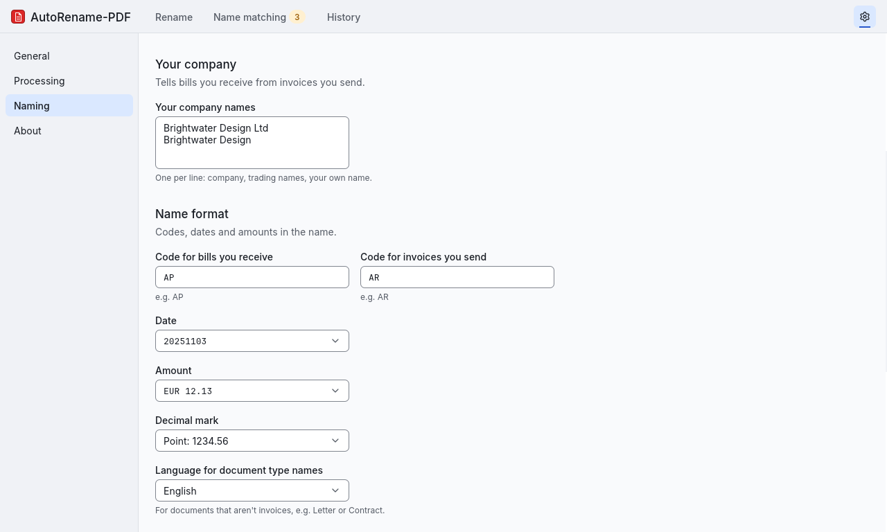
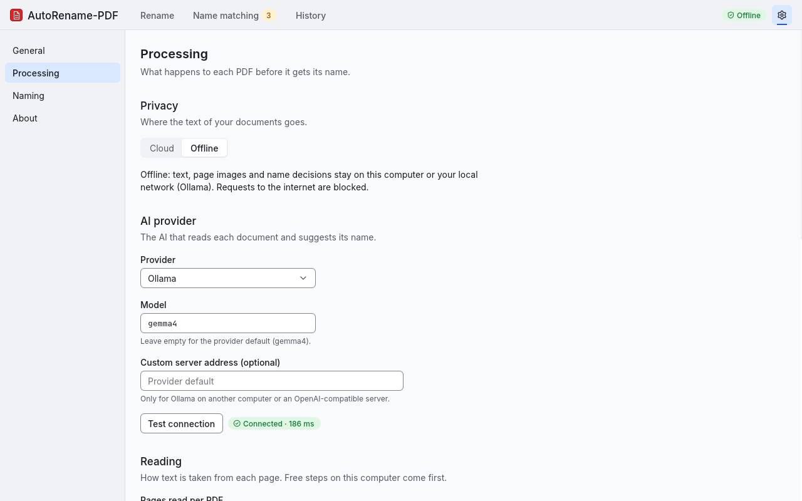
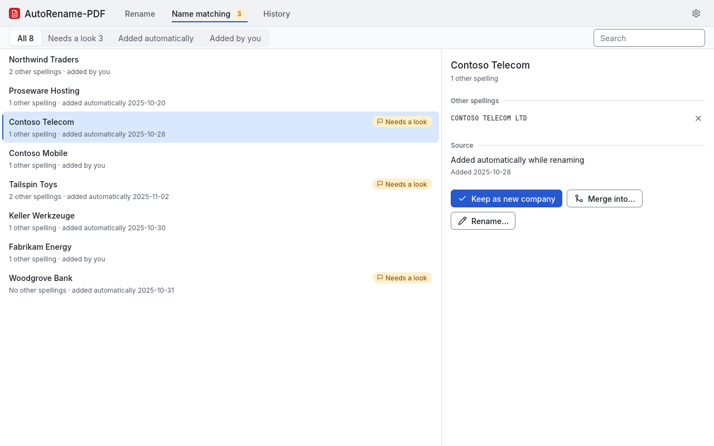

# AutoRename-PDF guide

Background for the [README](../README.md). Command options and side effects are in `autorename-pdf <command> --help`, exit codes in `autorename-pdf --help`; every config key is in [config.yaml.example](../config.yaml.example).

## Contents
- [Install details](#install-details)
- [How a PDF is read](#how-a-pdf-is-read)
- [Offline mode](#offline-mode)
- [Embedded data](#embedded-data)
- [Name matching](#name-matching)
- [Scripts and agents](#scripts-and-agents)

## Install details

| System | Notes |
|---|---|
| Windows | Per-user install to `%LOCALAPPDATA%\Programs\AutoRename-PDF`, no admin prompt. Adds the Start menu entry, the Explorer context menu and `autorename-pdf` on your user `PATH` (new terminals; otherwise `"%LOCALAPPDATA%\Programs\AutoRename-PDF\autorename-pdf.exe"`). Uninstall (Settings > Apps) removes only those; your settings, name lists and undo history stay in `%APPDATA%\autorename-pdf` and `%LOCALAPPDATA%\autorename-pdf`. |
| Linux | `integrate install` adds the menu entry, "Rename now" and "Preview in AutoRename-PDF" for Nautilus (Scripts submenu), Dolphin, Nemo and Thunar, and an `autorename-pdf` link in `~/.local/bin`. `integrate remove` deletes exactly those entries. Uninstall a package with `autorename-pdf integrate remove`, then `sudo apt remove auto-rename-pdf` (Ubuntu/Debian) or `sudo pacman -R auto-rename-pdf` (Arch). The AppImage is a single file: run `integrate remove` with it, then delete it. |
| macOS (Apple silicon) | Drag the app from the DMG into Applications. The command line is inside the app: `/Applications/AutoRename-PDF.app/Contents/MacOS/autorename-pdf` (`integrate install` adds Finder Quick Actions; not yet tested in the beta). Uninstall: `integrate remove`, then move the app to the Trash. |

### AppImage without FUSE

Containers, WSL and minimal systems often lack FUSE (`fusermount: not found`, exit 127). Check with `ls /dev/fuse && (command -v fusermount3 || command -v fusermount)`. Without it:

```bash
./autorename-pdf_*.AppImage --appimage-extract-and-run --help   # one-off (or: export APPIMAGE_EXTRACT_AND_RUN=1)
./autorename-pdf_*.AppImage --appimage-extract                  # permanent: unpack once …
mkdir -p ~/.local/opt && mv squashfs-root ~/.local/opt/autorename-pdf
~/.local/opt/autorename-pdf/AppRun integrate install            # … menu entries then point to this stable path
```

## How a PDF is read

Free, local steps come first, decided page by page for the first `pdf.max_pages` pages (default 3):

| Step | What | Cost | Setting |
|---|---|---|---|
| 1. Text layer | Text built into the PDF, with reading-order and broken-character repair | free, instant | always |
| 2. Local OCR | Reads the page image on your CPU: English, German and 46 more Latin-script languages | free, offline, ~0.5 s per page | `pdf.ocr`, `--ocr=auto\|on\|off` |
| 3. Vision | The page image is sent to the AI model | provider price per image | `pdf.vision`, `--vision=auto\|on\|off` |

A step runs only for pages whose score so far is below `pdf.text_quality_threshold` (default 0.8). Clean text scores 1.0; a page with pictures (a logo, a stamp) scores at most 0.75, so it is read again with the free local OCR, and a sender printed only in a logo is still found. OCR needs its models once (`autorename-pdf setup --ocr-models`, ~40 MB). Vision (`auto`) is only for pages that stay unreadable: scans without a text layer, or broken text that OCR could not fix. A clean text layer with a logo is never sent as an image; without OCR models a sender printed only in a logo is then missed and the file is flagged for review.

Then one AI request per document returns the fields of the profile. The app checks them, decides `AP`/`AR` from who issued and who received the document (compared with your company names: list every name your invoices show, such as the company, a trading or old name and your own name), keeps the company spelling consistent, builds the name, and adds `_(1)`, `_(2)` … when a name is taken. Existing files are never overwritten. Providers and their default models: [config.yaml.example](../config.yaml.example) (`ai:`).

`autorename-pdf inspect file.pdf` shows the score of each page and which step would run.

In the window, your company names, the document type codes, the date format and the decimal mark are under Settings > Naming:

<picture>
  <source media="(prefers-color-scheme: dark)" srcset="images/gui-settings-dark.png">
  
</picture>

## Offline mode

`privacy: offline` in the config (or `--offline` for one run) keeps every document on your computer or local network:

- The provider is a local Ollama at `localhost` or a LAN address. Any other network request is an error (exit 3), never a silent fallback. Proxy variables are ignored, redirects are never followed, and DNS answers must be loopback/LAN addresses.
- OCR runs locally; vision, when needed, uses the local Ollama model.
- The window shows an **Offline** badge in the header.

Checklist:

1. Install [Ollama](https://ollama.com) and download a model for your hardware: `ollama pull gemma4` (GPU or Apple silicon) or `ollama pull gemma4:e2b` (CPU only; smaller, a one-page invoice takes about a minute on an older laptop).
2. Before you switch to offline mode, download the scan reader (optional, ~40 MB): `autorename-pdf setup --ocr-models`. Offline mode never downloads. Already offline or air-gapped? Copy the `models` folder (`autorename-pdf config path` shows it) from a connected machine and run `autorename-pdf models import /media/usb/models`.
3. Switch to offline mode (no API key; checks that Ollama answers and has the model). Use `gemma4` if that is the model you downloaded:
   ```bash
   autorename-pdf setup --offline --ollama-model gemma4:e2b --company "Spqrk"
   ```
4. Preview your files: `autorename-pdf rename --dry-run --jobs 1 ~/Private` (one file at a time keeps a CPU model responsive).

Back to a cloud provider: `autorename-pdf setup --cloud --provider openai --api-key-env OPENAI_API_KEY` (offline mode is only ever left explicitly). Recipe: [examples/ollama-offline.yaml](../examples/ollama-offline.yaml). In the window: Settings > Processing > Privacy.

<picture>
  <source media="(prefers-color-scheme: dark)" srcset="images/gui-offline-dark.png">
  
</picture>

## Embedded data

On by default (`enrich.enabled`, `--no-enrich` for one run). After renaming, the app appends one incremental update to the PDF; the original bytes stay an exact prefix of the file.

| Written | Content |
|---|---|
| Info dictionary | `Title` (the new name without `.pdf` and without a `_(n)` suffix), `Subject` (document type + company), `Keywords`. `Author` and `CreationDate` are never touched. |
| XMP | Merged into the existing packet: every extracted field, profile, step, provider/model and timestamp (`arp:` namespace). |
| Attachment `autorename-pdf.json` | Fields, the text used per page, step, model, SHA-256 and length of the original. No prompts, keys or absolute paths. |

- **Skipped** (the file is still renamed, its content stays byte-identical): signed or certified PDFs, encrypted PDFs, PDF/A, e-invoices with embedded XML (ZUGFeRD / Factur-X), unparseable files.
- **Undo** truncates the file back to its original bytes, but only while it is unchanged since; otherwise that file reports a conflict.
- **Reading it back:** `autorename-pdf inspect file.pdf` (text) or `-o json` → `.files[0].embedded.attachment`; any PDF tool reads the attachment, e.g. `qpdf --show-attachment=autorename-pdf.json file.pdf` or `pdfdetach -save 1 -o data.json file.pdf`. Its shape: `autorename-pdf schema inspect`.

## Name matching

Every spelling of the same company gets one canonical form in your file names. Each harmonized field has its own list, `name-lists/<field>.yaml` beside the config (business: `name-lists/company_name.yaml`; academic: none, opt in with e.g. `harmonize_field: journal_name`).

```yaml
"ACME":
  aliases: ["ACME Corporation", "Acme Holding"]   # yours, never changed by the app
  learned: ["ACME Coporation"]                     # added by the app (OCR typo)
  source: user
```

- Company names are compared ignoring case, punctuation and legal forms (GmbH, AG, Inc, Ltd, LLC, SA, BV, …); other fields ignore only case, spacing and surrounding punctuation.
- **Auto-learning** (on by default, `--no-learn` for one run): a similarity of 0.92 or more adds a learned alias; 0.75–0.92 asks a small AI decider (`harmonization.decider`); below that creates a new entry. Without a decider verdict an ambiguous name becomes a new entry flagged `review`, never a silent merge.
- Learned names belong to the run's undo batch. `undo` removes them, but never an entry you renamed, merged or accepted. The whole lifecycle: `autorename-pdf names --help`.
- In the window: the Name matching tab. On the command line: `names list | review | merge | rename | add` (`--field journal_name` picks another list).

<picture>
  <source media="(prefers-color-scheme: dark)" srcset="images/gui-names-dark.png">
  
</picture>

Walkthrough on the [demo](../examples/demo/) (real output, OpenAI; the `ocr_models_missing` lines left out):

```console
$ autorename-pdf rename demo/initech-invoice.pdf
  initech-invoice.pdf  →  20240628 Initech Solutions AP EUR 237.50.pdf  enriched · new entry
Done: 1 renamed, 1 enriched, 1 name learned  (revert: autorename-pdf undo)

$ autorename-pdf names rename "Initech Solutions" "Initech Corp"   # your spelling from now on

$ autorename-pdf undo
  20240628 Initech Solutions AP EUR 237.50.pdf  →  initech-invoice.pdf
  Initech Solutions: kept: merged into "Initech Corp" by user
Undo: 1 restored, 0 failed, 1 metadata reverted, 0 names forgotten  (batch 20261110T100859-2abec9)

$ autorename-pdf rename --dry-run demo/initech-invoice.pdf
  initech-invoice.pdf  →  20240628 Initech Corp AP EUR 237.50.pdf
Dry run: 1 to rename (nothing changed)
```

The file is back under its old name, but your spelling stays. Starter file: [name-lists/company_name.yaml.example](../name-lists/company_name.yaml.example).

## Scripts and agents

`autorename-pdf --help` covers the machine contract (JSON and NDJSON output, error documents, exit codes, isolated runs, Windows notes); `apply --help` covers editing a plan, `undo --help` the order in which runs are undone, `autorename-pdf schema` every JSON Schema. Setting the app up for someone: [AGENTS.md › Setup runbook](../AGENTS.md#setup-runbook).
